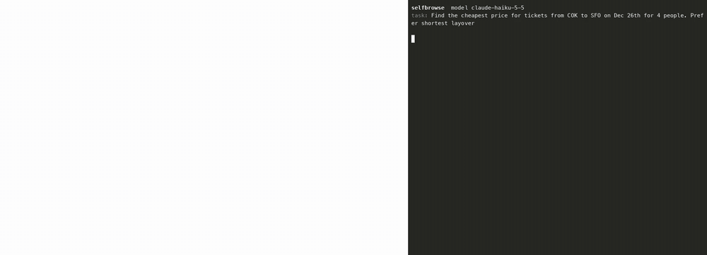
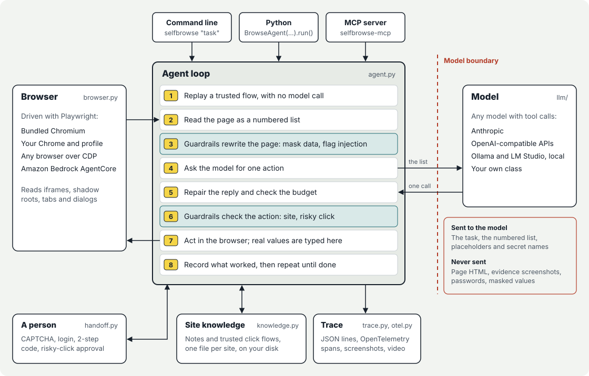

<p align="center">
  <picture>
    <source media="(prefers-color-scheme: dark)" srcset="https://raw.githubusercontent.com/rinshadkk/selfbrowse/main/site/logo/selfbrowse-logo-dark.svg">
    
  </picture>
</p>

<h3 align="center">The browser agent that tells the model less.</h3>

<p align="center">
  <a href="https://selfbrowse.ai/">selfbrowse.ai</a> ·
  <a href="https://selfbrowse.ai/docs/">Documentation</a> ·
  <a href="https://pypi.org/project/selfbrowse/">PyPI</a>
</p>

<p align="center">
  <a href="https://pypi.org/project/selfbrowse/"></a>
  <a href="https://pypi.org/project/selfbrowse/"></a>
  <a href="https://github.com/rinshadkk/selfbrowse/actions/workflows/ci.yml"></a>
  <a href="https://github.com/rinshadkk/selfbrowse/blob/main/LICENSE"></a>
</p>

Selfbrowse is an open-source Python browser agent for LLMs. It gives the model a short numbered list of page elements instead of the DOM or screenshots, so runs use fewer tokens, with built-in personal-data redaction, guardrails, tracing and learned-click replay. You describe a task in plain language and it drives a real browser to do it. It works as a Python library, a command line tool and an MCP server, with Claude, OpenAI, Gemini, Groq, Ollama and OpenRouter models.

Most browser agents hand the model everything: a screenshot or a large slice of the page, your data as it appears on screen, and the same cookie banner on every visit. Selfbrowse sends less of all three, which makes it cheap enough for a model on your laptop and careful enough for sites you are signed in to.

```bash
pip install selfbrowse && playwright install chromium
selfbrowse "Open news.ycombinator.com and tell me the title of the top story."
```

<p align="center">
  
</p>
<p align="center"><sub>A real run, not a mock-up: Claude Haiku 5.5 finds the cheapest COK to SFO fare for 4 people on Google Flights in 7 steps. It took about 30 seconds and is shown at 1.3× speed. The prompt and the other runs are under <a href="https://github.com/rinshadkk/selfbrowse/blob/main/docs/benchmarks.md#showcase">Showcase</a> in the docs.</sub></p>

## Less page, less of your data, less repetition

**Less page.** The model reads each page as a short numbered list of what a person could click or type into, and answers with a number. No screenshots, no HTML, and only the newest list stays in the conversation.

```
['Corner Shop | Lamps' | https://corner-shop.test/lamps]
#1 link "Corner Shop" (→/)
#2 textbox "Search products"
#3 button "Search"
#4 link "Cart (0)" (→/cart)
#5 heading "Desk Lamp"
#6 combobox "Finish" (value="Brass", options: Brass | Black | White)
#7 button "Add to cart"
#8 button "Accept"
```

The model replies `click {"ref": 7}`. On 13 tasks with Claude Haiku 5.5, the first model call averaged 2,306 tokens with Selfbrowse and 17,703 with browser-use.

**Less of your data.** Passwords, emails, phone numbers, card numbers and (with Presidio) names reach the model as placeholders such as `<secret:pw>` and `<EMAIL_1>`. The model types the placeholder and Selfbrowse swaps in the real value at the keyboard, on the same site only. In a check with a local model, the form was filled with the real values in 5 of 5 runs and the model saw them in 0 of 5.

```
The page shows      Email on file: priya.raman@acme.com
The model reads     Email on file: <EMAIL_1>
The model replies   type {"ref": 2, "text": "<EMAIL_1>"}
The page receives   priya.raman@acme.com
```

**Less repetition.** Selfbrowse remembers the clicks that worked on each site and can replay the trusted ones without calling the model. In small tests on a demo shop with qwen3.8 and Claude Haiku 5.5, replay rarely triggered and we measured no reliable saving. Treat it as experimental.

```
   1. goto {"url": "https://shop.example.com"}  [845 in / 65 out]
   2. click {"ref": 8}  [0 tokens] (learned: replayed from saved flow, no model call)
```

## How it works

<p align="center">
  
</p>

Selfbrowse is one loop with a browser on one side and a model on the other. Guardrails act twice in every step: once on the page before the model reads it, and once on the action before the browser runs it. Real values exist only at step 7, where they are typed. Each step, the module layout and the places you can plug in your own code are in [Architecture](https://github.com/rinshadkk/selfbrowse/blob/main/docs/architecture.md).

## Quick start

```bash
pip install selfbrowse
playwright install chromium        # or use your installed Chrome with --channel chrome
```

With Claude (set the key in your own shell):

```bash
export ANTHROPIC_API_KEY=your-key-here
selfbrowse "Open news.ycombinator.com and tell me the title of the top story."
```

With a free local model through [Ollama](https://ollama.com), no key:

```bash
selfbrowse -m ollama:qwen3.6:latest "Open news.ycombinator.com and tell me the title of the top story."
```

Add `--headed` to watch the browser. Each step prints with the tokens it used, and the last line gives the totals:

```
   1. goto {"url": "https://example.com"}  [845 in / 65 out]
   2. done {"success": true, "answer": "The heading is Example Domain."}  [901 in / 76 out]
[2 steps, 2 model calls, 1746 in / 141 out tokens, 24.1s]
The heading is Example Domain.
```

A step that shows `[0 tokens]` came from the same reply as the one before it, or was replayed from saved knowledge. `-q` hides the steps and `--json` prints the full result.

From Python:

```python
from selfbrowse import BrowseAgent
from selfbrowse.guardrails import AllowedDomains, ConfirmRisky, RedactPII, Budget

result = BrowseAgent(
    "Find the cheapest desk lamp and add it to the cart",
    llm="ollama:qwen3.6",
    guardrails=[
        AllowedDomains(["shop.example.com"]),   # stay on this site
        ConfirmRisky(),                          # ask before Buy, Pay, Delete, Send
        RedactPII(),                             # emails, phones, cards become placeholders
        Budget(max_tokens=50_000),
    ],
).run()

print(result.output)
print(result.usage)        # input, output and cache tokens, and the number of model calls
```

There are fourteen runnable scripts in [examples/](https://github.com/rinshadkk/selfbrowse/blob/main/examples/README.md). Three of them need no API key.

## Measured against other agents

Selfbrowse and browser-use ran the same 13 tasks (a demo shop and real sites) on Claude Haiku 5.5 through the Anthropic API, 2 runs per task, with the same browser and limits. Code judges success (the demo shop's state, or a fact from the site's own API), never the agent's own claim. Tokens are what the model itself reported for every call, input plus output, added up over the run. Measured on 25 November 2026.

| Library | Passed | Tokens per task | Input | Output | First model call | Model calls | Seconds per task |
|---|---|---|---|---|---|---|---|
| **Selfbrowse** | 26/26 | **19,520** | 18,931 | 589 | **2,306** | 5.3 | **7** |
| browser-use 0.13.14 | 26/26 | 66,661 | 64,768 | 1,893 | 17,703 | **4.5** | 14 |

What this does and does not show:

- **Selfbrowse used 3.4 times fewer tokens**, and fewer on all 13 tasks, from 1.3 to 6.6 times. It was also faster on 12 of the 13.
- **Each Selfbrowse call is small, but it makes more of them** (5.3 against 4.5), which is why the gap in total tokens is smaller than the gap in the first call.
- **Both passed every run.** This run does not separate them on success.
- **Tokens are not cost.** Much of the input for both libraries was served from the prompt cache, which is billed at a lower rate.
- **This is a small sample:** one model, 2 runs per task, one machine. Treat it as a measurement, not a ranking.

The harness, per-run data and versions are in [benchmarks/compare](https://github.com/rinshadkk/selfbrowse/tree/main/benchmarks/compare), so you can rerun it on your own models. More detail, and three showcase tasks on live sites with their cost per run, are in [Tests and benchmarks](https://github.com/rinshadkk/selfbrowse/blob/main/docs/benchmarks.md).

## What is in the box

| | What you get | Read more |
|---|---|---|
| **Models** | Anthropic, OpenAI, Gemini, Groq, DeepSeek, OpenRouter, Together, Ollama and LM Studio by name (`provider:model`). Any gateway that speaks the Anthropic or OpenAI API. Your own model as a small class. | [Models](https://github.com/rinshadkk/selfbrowse/blob/main/docs/models.md) |
| **Guardrails** | Domain allow and block lists, approval before risky clicks, a watch for prompt injection in page text, token, time and dollar budgets, and your own rules as a small class. | [Guardrails](https://github.com/rinshadkk/selfbrowse/blob/main/docs/guardrails.md) |
| **Personal data** | `--redact-pii` for emails, phones, SSNs and cards. `--redact-presidio` adds names with Microsoft Presidio, running on your machine. `--review-payload` stops and shows the exact request before each model call, so you can send it, mask it or stop. | [Personal data](https://github.com/rinshadkk/selfbrowse/blob/main/docs/personal-data.md) |
| **Secrets** | Passwords are given by name and typed at the keyboard. They never appear in prompts, results or traces. | [Passwords and secrets](https://github.com/rinshadkk/selfbrowse/blob/main/docs/secrets.md) |
| **Hand-off** | When a CAPTCHA, login or 2-step code appears, the run pauses and you finish that step in the browser window. Selfbrowse does not solve CAPTCHAs. | [CAPTCHAs and hand-off](https://github.com/rinshadkk/selfbrowse/blob/main/docs/captcha-handoff.md) |
| **Flows** | `--save-flow fare` saves a whole run; `selfbrowse flow run fare --param to=LHR` replays it with no model and no tokens. | [Flows](https://github.com/rinshadkk/selfbrowse/blob/main/docs/flows.md) |
| **Learning** | Per-site notes and click flows, replayed only once trusted. `selfbrowse sites` lists them and `selfbrowse forget <domain>` clears one. | [How learning works](https://github.com/rinshadkk/selfbrowse/blob/main/docs/tools.md#how-learning-works) |
| **Observability** | `--trace` for a local timeline of every prompt, reply and action. `--otel URL` for OpenTelemetry spans in Jaeger, Phoenix, Langfuse or Tempo. Screenshots and video as evidence. | [Traces, prompts and screenshots](https://github.com/rinshadkk/selfbrowse/blob/main/docs/observability.md) |
| **MCP server** | `selfbrowse-mcp` gives Claude, VS Code and other MCP clients a browser, as one `browse(task)` tool or step by step. | [MCP server](https://github.com/rinshadkk/selfbrowse/blob/main/docs/mcp.md) |
| **Remote browsers** | Attach to any browser over CDP with `--cdp-url`, or start an Amazon Bedrock AgentCore session with `--cloud agentcore`. | [Remote browsers](https://github.com/rinshadkk/selfbrowse/blob/main/docs/remote-browsers.md) |
| **Page coverage** | Iframes (same and cross origin), open shadow roots, native dropdowns, new tabs and popups, JavaScript dialogs. | [What the agent can do](https://github.com/rinshadkk/selfbrowse/blob/main/docs/tools.md) |

Every option is in the [command line reference](https://github.com/rinshadkk/selfbrowse/blob/main/docs/cli.md).

## Use it as the browser for Claude or VS Code

```bash
pip install 'selfbrowse[mcp]'
claude mcp add selfbrowse -- selfbrowse-mcp --model ollama:qwen3.6 --headed
```

In task mode the assistant calls `browse(task)` and gets back only the answer. A cheap or local model reads the pages, so they never enter the assistant's context. In step mode the assistant drives the browser itself and reads the numbered list. Config for VS Code and Claude Desktop is in the [MCP guide](https://github.com/rinshadkk/selfbrowse/blob/main/docs/mcp.md).

## Signing in without showing the model your password

```bash
export SELFBROWSE_SECRET_user='me@example.com'
read -s "SELFBROWSE_SECRET_pw?Password: " && export SELFBROWSE_SECRET_pw     # zsh

selfbrowse --headed --allow-domain example.com --redact-pii \
  "Go to example.com/login, sign in with <secret:user> and <secret:pw>, then tell me my latest order number"
```

The model is told only the names. `--allow-domain` means the values can be typed on that site and nowhere else, and `--redact-pii` hides what the account page shows back.

## Limits

Selfbrowse is early software (0.4). What we know it does not do well yet, or have not checked:

- **Not supported yet:** closed shadow roots, and vision (`--vision` is a stub, so canvas-only pages cannot be read).
- **Partly supported:** a saved flow cannot replay an upload or a drag. Drag does not cover sliders, canvas drawing, or drop targets that a library listens for at the page root. Custom dropdowns match visible text only, and choices that need scrolling inside the list are found only once they exist in the page. Uploads use only the files you pass with `--file`.
- **Learning has no measured saving yet.** In small tests on a demo shop with qwen3.8 and Claude Haiku 5.5, replay rarely triggered and we measured no reliable saving. Research-style tasks learn little.
- **Hard forms vary.** The same Google Flights prompt took 7 steps in one run and more than 30 in two others.
- **Guardrails reduce risk; they are not guarantees.** Pattern matching for personal data and injection misses things. A hosted model still sees any page text you do not mask. Only a local model keeps page content on your machine.
- **Secrets tied to a site are only as strong as the tie.** In the desktop app, a My info form with a Website field types its values only on that site and its subdomains. A form without one still types anywhere, and replaying a saved flow does not check the site yet. The library's `sensitive_sites` is checked at typing time, and `--allow-domain` remains the stricter fence.
- **The desktop app is unsigned.** The macOS build is for Apple Silicon only, needs Chrome installed, and macOS asks you to approve it on first open. The optional Presidio download works only after the add-on is published and its checksum is pinned in the app.
- **Untested against live accounts:** the AgentCore adapter and the Azure and Bedrock model routes are tested with stand-ins.
- **Benchmarks are small.** See the notes under the table above.

What comes next is in the [roadmap](https://github.com/rinshadkk/selfbrowse/blob/main/ROADMAP.md).

## Develop

```bash
git clone https://github.com/rinshadkk/selfbrowse && cd selfbrowse
python3 -m venv .venv && source .venv/bin/activate
pip install -e '.[dev]'
playwright install chromium
python -m pytest -q
```

Browser tests use local fixture pages and a faked model, so no API key is needed. See [CONTRIBUTING.md](https://github.com/rinshadkk/selfbrowse/blob/main/CONTRIBUTING.md).

## License

MIT.
