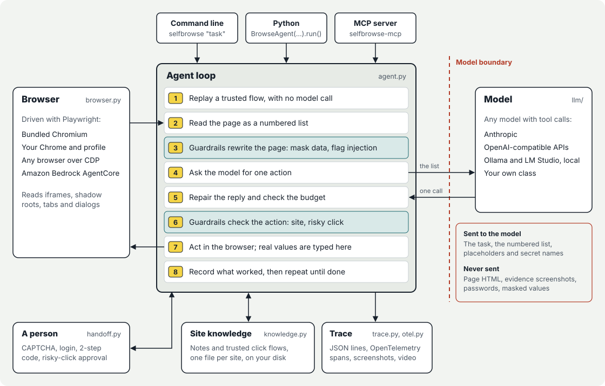

# Architecture

Selfbrowse is one loop with a browser on one side and a model on the other. Everything else exists to control what crosses from the first to the second.

## One step of the loop

The loop lives in `agent.py` (`BrowseAgent._loop`). Each pass does the following, in this order.

1. **Replay a trusted flow.** If site knowledge holds a trusted click sequence for this page type, the clicks run with no model call. Each replayed click still passes the guardrails; if one objects, or the element cannot be found, the replay stops and the model takes over.
2. **Read the page.** `Browser.snapshot()` returns a numbered list of what is usable in the viewport, up to 120 controls, including those in iframes and open shadow roots. If the page looks like a bot check, the loop pauses for a person before going on.
3. **Guardrails rewrite the page.** Each guardrail's `on_page` hook sees the list before the model does. This is where personal data becomes placeholders such as `<EMAIL_1>` and where instruction-like page text is flagged.
4. **Ask the model.** The request holds the system prompt, the tool schemas, the task and the conversation. Only the newest page list is kept, along with the two most recent `read` results; older ones are trimmed first.
5. **Repair the reply and check the budget.** A tool call written as text, a wrong argument name or an unknown tool is fixed or answered with what to send. Budget guardrails (`after_step`) stop a run that has gone over.
6. **Guardrails check the action.** `check_url` judges where a `goto` would land, and `before_action` judges the click or typing. A guardrail can block the action, or ask a person to confirm it. With nobody to ask, a confirmation becomes a block.
7. **Act in the browser.** The tool runs through Playwright. This is the only point where real values exist: `<secret:NAME>` and `<EMAIL_1>` are swapped for the real text as it is typed, and a placeholder is refused on any site it was not seen on.
8. **Record what worked.** A click that opened another page or dismissed a banner is noted for this page type. The notes are written to disk only if the run succeeds.

The run ends when the model calls `done`, a guardrail stops it, the step limit is reached, or a person declines a hand-off.

## The model boundary

The red line in the diagram is the reason for the design.

| Sent to the model | Never sent |
|---|---|
| The task text | Page HTML |
| The numbered list for the current page | Evidence screenshots and video (`--screenshots`, `--record-video`) |
| Text from `read` and `find`, after masking | Secret values; the model sees only `<secret:NAME>` |
| Placeholders such as `<EMAIL_1>` | The values behind placeholders |
| Saved notes about the site | What a person types or sees during a hand-off |

Two limits apply. Page text that no guardrail masks is sent as it appears, so a hosted model does see it; only a local model keeps page content on your machine. And masking is pattern matching, so it lowers exposure and does not prove that nothing leaked. See [Personal data](personal-data.md).

## Modules

| Module | What it holds |
|---|---|
| `agent.py` | `BrowseAgent`: the loop, reply repair, loop guards, hand-off, replay and learning hooks |
| `browser.py` | `Browser`: Playwright wrapper, the page snapshot, tabs, dialogs, frames, CDP attach |
| `tools.py` | The tool schemas sent to the model, and the repair of sloppy tool calls |
| `prompts.py` | The system prompt and the context-trimming constants |
| `guardrails.py` | The `Guardrail` base class, the built-in guardrails, and the placeholder vault |
| `knowledge.py` | `SiteKnowledge`: per-site notes and click flows, and the trust rules |
| `handoff.py` | Bot-check detection and the terminal prompt for a person |
| `llm/` | The `LLM` protocol, the Anthropic client, and the OpenAI-compatible client with its JSON mode |
| `trace.py`, `otel.py` | `Tracer`, the trace file format, the timeline renderer, and the OpenTelemetry sink |
| `cloud.py` | Remote browser adapters (`CloudBrowser`), including Amazon Bedrock AgentCore |
| `cli.py`, `mcp_server.py` | The two command line entry points |

## Where you can plug in

Each of these is a small interface, so none needs a change to the loop.

| To change | Provide | Read more |
|---|---|---|
| The model | An object with `model` and `complete(system=, messages=, tools=, max_tokens=)` | [Models](models.md#bring-your-own-model) |
| What is allowed | A `Guardrail` subclass overriding `on_page`, `check_url`, `before_action` or `after_step` | [Guardrails](guardrails.md) |
| How a person is asked | A `handoff=` function that takes a request and returns `True` to continue | [CAPTCHAs and hand-off](captcha-handoff.md) |
| Where traces go | A sink with `handle(event)` and `close()`, or `redact_trace=` to scrub text | [Observability](observability.md) |
| Where the browser runs | A CDP address, or a `CloudBrowser` with `open()` and `close()` | [Remote browsers](remote-browsers.md) |

## The MCP server

`selfbrowse-mcp` wraps the same parts in two ways.

- **Task mode** (`browse(task)`) runs the whole loop above with the server's own model and returns only the answer. The calling assistant never reads the pages.
- **Step mode** (`browser_snapshot`, `browser_click` and the other `browser_*` tools) skips the loop. The calling assistant is the model: it reads the numbered list and picks each action. Guardrails still run on every page and every action, and a confirmation is refused because there is no terminal to ask in.

Both modes share one browser. See [MCP server](mcp.md).

## What is stored on disk

Everything is under `~/.selfbrowse`, or `$SELFBROWSE_HOME`.

| Path | Contents | Written when |
|---|---|---|
| `sites/<domain>.json` | Notes and click flows for one site. Never typed text, and never risky clicks. | A run succeeds, unless `--no-learn` |
| `traces/<run-id>.jsonl` | One JSON line per event | `--trace` |
| The folder you name | Screenshots, an `index.html`, or video | `--screenshots`, `--record-video` |

The mapping from a placeholder to its real value is held in memory for the length of a run and is never written to disk.
